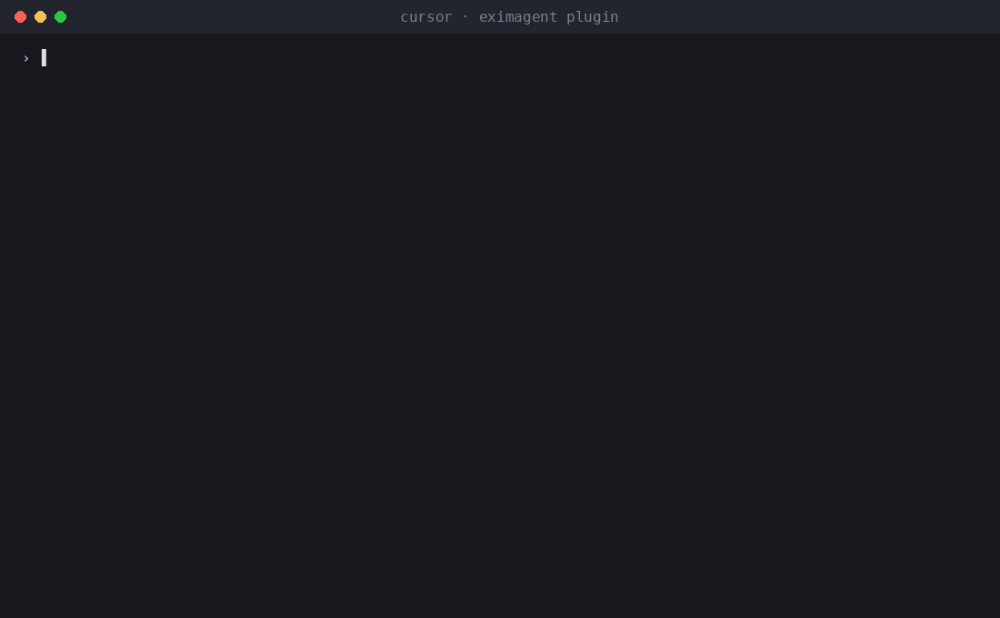

# EximAgent plugin

[](https://skills.sh/EximAgent/cursor-plugin)

EximAgent is a team of AI agents for the export-import industry, connected to Claude, Cursor and other AI clients through one MCP connector. Outbound finds importers and buyers and writes personalized outreach. Analyst digs into trade data: market size, price trends, trade flows and company profiles. Compliance handles HS classification, tariffs, landed cost and OFAC screening.

**An AI sales team for export-import:** Outbound, Analyst and Compliance, in Claude Code, Cursor and other AI clients. Free to start.



Ask in plain words, and your assistant uses [EximAgent](https://eximagent.ai) to:

- find importers, buyers and distributors from real customs shipment records
- look up HS codes, tariffs and duties for a trade lane
- screen company or person names against the OFAC sanctions list
- research a company from its website
- write personalized outreach emails to the buyers it finds

## What's inside

| Part | What it does |
| --- | --- |
| `mcp.json` | Connects to the hosted EximAgent connector at `https://mcp.eximagent.ai/mcp` (streamable HTTP, OAuth sign-in) |
| `skills/eximagent` | Teaches the assistant to use the EximAgent connector: which agent and tool to use for prospecting, trade data analysis and compliance checks |
| `skills/eximagent-cli` | Teaches assistants that have a terminal to install and use the `eximagent` command-line tool |

## Set up (about 2 minutes)

You need an EximAgent account. See [pricing](https://eximagent.ai/pricing).

### Cursor

Add the hosted connector to `~/.cursor/mcp.json`:

```json
{ "mcpServers": { "eximagent": { "url": "https://mcp.eximagent.ai/mcp" } } }
```

Then open Cursor's MCP settings, choose **Connect** on `eximagent`, and sign in with Google in the browser window that opens.
If you already use the `eximagent` CLI and are signed in, `eximagent connect cursor` writes this config for you.

### Claude Code

```bash
claude mcp add --transport http eximagent https://mcp.eximagent.ai/mcp --scope user
```

Then run `/mcp` in Claude Code and sign in with Google. (CLI users who are signed in can run `eximagent connect claude-code` instead.)

### Other assistants

- **Grok Bot:** open **Connect Apps**, find **EximAgent**, choose **Add**, then sign in with Google.
- **Codex:** `codex mcp add eximagent --url https://mcp.eximagent.ai/mcp`, then `codex mcp login eximagent`.
- **Claude desktop or web:** Settings → Connectors → Add custom connector → `https://mcp.eximagent.ai/mcp`.

### Skills only (any agent that supports Agent Skills)

Add the two EximAgent skills to Claude Code, Codex, Cursor and other agents with the open-source [`skills` CLI](https://skills.sh):

```bash
npx skills add EximAgent/cursor-plugin
```

To add one skill only, use `--skill eximagent` (for the connector) or `--skill eximagent-cli` (for the command-line tool). The skills work together with the EximAgent connector or the `eximagent` CLI.

Full connector guide: https://eximagent.ai/docs/integrations/mcp

## What you can ask

Outbound:
- "Find importers of green coffee in Germany from customs shipment records and shortlist the best five."
- "Research this buyer's website and write a personalized first email."

Analyst:
- "How big is the US market for frozen shrimp imports, and who are the top importers?"
- "Show the price trend and main trade routes for cashew nuts shipped into the Netherlands."

Compliance:
- "What HS code fits frozen shrimp, and what duty applies shipping it from Vietnam to Germany?"
- "Screen these three company names against the OFAC sanctions list."

## Access

- Lookups (HS codes, tariffs, sanctions, trade questions) only read data.
- The connector reads the account you sign in with and the EximAgent trade data. It does not read your files, your mail
  or your other connectors.

## Use the command-line tool

If your assistant can run terminal commands (for example Grok Bot, Cursor's terminal, Claude Code or Codex), it can also use
the `eximagent` command-line tool. This helps when the connector isn't set up, or for scripts and long lists. The
[`eximagent-cli` skill](skills/eximagent-cli/SKILL.md) tells the assistant how to install it with the official installer,
let you sign in yourself, and run the main commands. You sign in
in your own browser. Never paste a password or token into the chat.

## Help

- Docs: https://eximagent.ai/docs
- Contact: brickai@eximagent.ai
- Command-line tool (for developers): https://github.com/EximAgent/cli

If this is useful, a star helps others find it. ⭐

## License

The files in this repository (manifest, MCP config, skills and README) are released under the MIT License. See
[LICENSE](LICENSE).
Using the EximAgent service is governed by the [EximAgent Terms](https://eximagent.ai/policies/terms) and
[Privacy Policy](https://eximagent.ai/policies/privacy).
